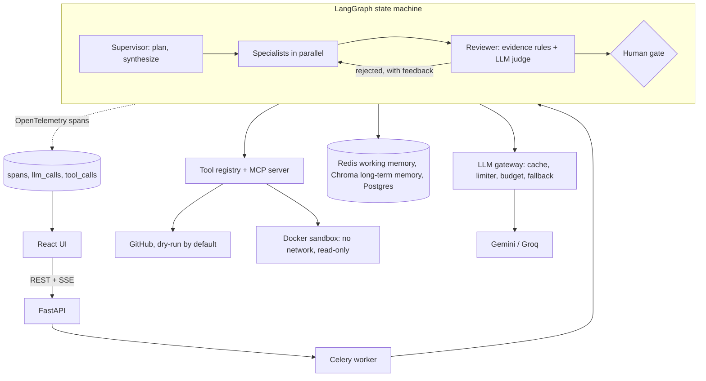

<div align="center">

# Conductor

**A multi-agent code-review and DevOps orchestrator that cannot merge or deploy by design.**

[](https://github.com/AyushModi-byte/Agent_Orchestration_System/actions/workflows/ci.yml)


</div>

A supervisor breaks a pull-request review into dependency-ordered subtasks. Four tool-using specialists (code analysis, security, test execution, fix writing) do the work in parallel, and a reviewer agent rejects any claim that does not cite real tool output. Sensitive steps pause for a human, past reviews teach it what to do next time, and every decision is traced and priced.

It runs on free-tier Gemini and Groq. The full test suite and the demo run with zero quota.

## Screenshots

**Run console.** Plan DAG and live progress for a review. Here the run is paused for a human decision.


**Review queue.** The human gate: proposed action, reasoning, memories, past decisions, and a chat with the agent before approving.


**Trace explorer.** Every agent step and tool call as a span, with latency and cost.


## Highlights

- **Evidence before opinion.** The reviewer checks findings against tool output before it spends a model call.
- **Human in the loop.** Four approval levels defined in YAML. Runs pause and resume from a LangGraph checkpoint.
- **Sandboxed execution.** No network, read-only root filesystem, CPU and memory limits, timeout.
- **One door for model calls.** Cache, rate limiter, daily budget and fallback live in a single gateway.
- **Memory.** Redis working memory and Chroma long-term memory feed later plans.
- **Observable.** OpenTelemetry spans, per-agent cost and deterministic replay.

## Architecture



## Metrics

Measured on this repository today (no model quality claims are made from scripted runs):

| What | Value |
| --- | --- |
| Python tests (unit, integration, e2e) | 130+ passing, 4 Docker-only skipped without Docker |
| UI tests (Vitest) | 14 passing |
| Type checking | mypy strict clean on `src/`, `tsc --noEmit` clean |
| Scripted demo | 2 PRs, 6 subtasks, 1 reviewer rejection, 1 human gate, runs in a few seconds |
| Live demo cost, tokens, latency, rejection rate | _filled in after the one live recording (`LIVE_LLM=1 make demo ARGS=--live`)_ |

## Quickstart (5 minutes)

You need Python 3.11+, Node 20+ (for the UI) and, for the full stack, Docker.

```bash
git clone https://github.com/AyushModi-byte/Agent_Orchestration_System.git
cd Agent_Orchestration_System

# with uv (recommended)
uv sync

# or with pip
python -m venv .venv && . .venv/bin/activate        # Windows: .venv\Scriptsctivate
pip install -e . pytest pytest-asyncio ruff mypy
```

| Command | What it does |
| --- | --- |
| `make demo` | Scripted two-PR scenario. Zero quota, no network. |
| `make demo-ui` | API in demo mode plus the Vite dev server on http://localhost:5173 |
| `make up` | Full stack in Docker: api, worker, beat, redis, postgres, chroma, web. UI on :8080, API docs on :8000/docs |
| `CONDUCTOR_FAKE_LLM=1 make up` | Same stack with scripted models, no API keys needed |
| `make test` | ruff, mypy, pytest, UI build and UI tests |
| `scripts/fresh_clone_check.sh` | Clone, install, up, demo, with timing |

Real models: copy `.env.example` to `.env`, add `GEMINI_API_KEY` and `GROQ_API_KEY`. Nothing calls a provider unless `LIVE_LLM=1`. GitHub writes are dry runs unless `DRY_RUN=0`.

## Features

| Spec | Where |
| --- | --- |
| Supervisor plans a DAG with confidence and rationale | `agents/supervisor.py`, `graph/builder.py` |
| Four specialists with bounded tool loops and per-agent tool permissions | `agents/specialists`, `config/agents.yaml`, `tools/registry.py` |
| Reviewer: evidence rules first, LLM judge second, different model family | `agents/reviewer.py`, `config/models.yaml` |
| Tool registry (schemas, permissions, rate limits, logging, tracing) and MCP server | `tools/` |
| Sandboxed execution: no network, read-only root, limits, timeout | `tools/sandbox.py`, `sandbox/Dockerfile` |
| LLM gateway: cache, rate limiter, daily budget, fallback, schema retry | `llm/` |
| Working memory (Redis) and long-term memory (Chroma) with importance, consolidation, expiry, delete | `memory/` |
| Four human-in-the-loop levels, policy in YAML, interrupt/resume, chat before deciding | `hitl/`, `graph/gates.py`, `config/policies.yaml` |
| Tracing, per-agent cost, deterministic replay with diff | `obs/` |
| UI: run console, review queue, trace explorer, memory, cost | `web/` |
| Demo, planted-bug repo seeder, e2e behaviours | `demo/`, `tests/e2e/` |

## Design decisions and trade-offs

Full records in [docs/decisions.md](docs/decisions.md). The ones that shape the code:

- **No merge, no deploy.** There is no such tool; merging is the human "take over" level. Less autonomy, a whole class of risk removed.
- **One door for model calls.** Cache, limiter, budget and fallback live in the gateway, so free tiers stay predictable and replays are free. Cost: every caller must accept a gateway-shaped interface.
- **LangGraph `interrupt()` for human pauses**, resumed from a checkpoint, even from another worker. Couples us to LangGraph persistence.
- **Evidence before opinion.** The reviewer rejects findings that do not match tool output before spending a model call.
- **Notional pricing.** Free tiers bill nothing, so cost is estimated from `config/prices.yaml`; it ranks things correctly but is not an invoice.
- **Demo mode runs the real graph** on a scripted model, not a UI mock. It shows behaviour, not model quality.

## Test tiers

T0 unit and T1 integration run on FakeLLM and fake tools; e2e covers the showcase and six behaviours (valid plans, correct tool use, the reviewer catching bad output, memory improving a repeat plan, escalation at the right moments, recovery from agent failure); `pytest -m docker` exercises the real sandbox; `pytest -m live` is the only tier that spends quota and needs `LIVE_LLM=1`. CI runs `make test` without it.

## Limitations

- Not yet run against real Postgres checkpoints, a real Chroma server or real MiniLM embeddings in CI; the compose stack is defined but depends on your Docker.
- The worker mounts the host Docker socket for sandboxes (root-equivalent). Fine locally; use gVisor or Firecracker in production.
- Tables are created with `create_all`, not migrations.
- Replay runs inside the API process. The scripted demo shows behaviour, not model quality.
- Memory delete is per user, not per item. Free-tier models are slow and rate limited.

## Roadmap

Alembic migrations; per-item memory edit and delete; GitHub App auth and webhook-triggered reviews; gVisor sandbox; replay as a background job; richer eval suite on recorded cassettes; more specialists (docs, performance).

Docs: [architecture](docs/architecture.md) · [decisions](docs/decisions.md) · [API](docs/api.md) · [demo script](docs/demo.md)

## License

MIT. See [LICENSE](LICENSE).
