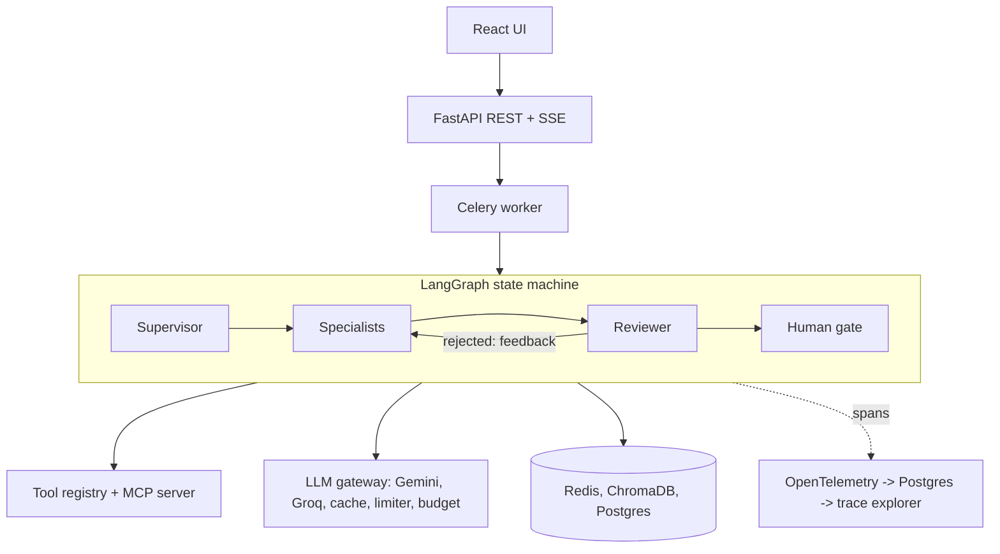

# Architecture

## Flow
UI -> FastAPI -> Celery worker -> LangGraph graph. Specialists reach the outside world only through the tool registry. Every model call goes through the LLM gateway. The reviewer can send work back. Low confidence, repeated failure or a sensitive step pauses at the human gate, which appears in the React review queue. OpenTelemetry spans from each agent step, tool call and memory lookup feed the trace explorer.



## Graph
intake -> plan -> dispatch (parallel for independent subtasks, honouring depends_on) -> review -> synthesize -> deliver.
Conditional edges:
- Specialist failure: retry with an alternate-approach hint (max 2).
- Reviewer rejection: back to the specialist with feedback (max 2).
- Low plan confidence, repeated failure, sensitive operation, low reviewer score, explicit request: escalate to the human gate.

## Agents
- Supervisor: plan(task, retrieved_memories) with structured output and DAG validation; synthesize(results).
- Specialists: code_analysis, security, test_execution, fix_writer. Bounded tool-use loops, restricted to permitted tools. Prompts in agents/prompts/*.md.
- Reviewer: approves only if every finding cites file+line from real tool output, fixes have passing tests, and no claim lacks evidence.

## Tools
Registry entries have name, description, input/output schemas, allowed agents, rate limit. Every call is logged (inputs, outputs, latency, success) and traced. Tools: GitHub (get_pr, get_pr_diff, list_pr_files, get_file, post_review_comment, push_fix_commit), sandboxed run, ruff, bandit, pytest, OSV dependency audit. No merge or deploy tool exists. The registry is also served over MCP.

## Memory
- Short-term (Redis): per task_id; plan, subtask outputs, intermediates, error log; TTL and cleared on completion.
- Long-term (ChromaDB, local embeddings): task_memories, repo_facts, user_prefs. Metadata: user_id, repo, type, created_at, importance, access_count, last_accessed.
- Extraction after completion: request, approach that worked/failed, tools used, repo conventions, observed preferences, human accept/reject of fixes.
- Retrieval before planning: similar past plans, what worked, what failed, preferences, facts, injected into the planning prompt.
- Management: importance score (access, recency, human feedback), consolidation of near-duplicates, expiry by decay, dashboard, delete endpoint.

## Human-in-the-loop
Levels: notify (proceed and inform), approve_action (confirm next step), approve_plan (review whole plan before work), take_over (human supplies output, agents stand down).
Defaults (config/policies.yaml): post_review_comment = notify; push_fix_commit = approve_action; production-labelled repo = approve_plan; repeated failure or any merge request = take_over.
Escalation uses LangGraph interrupt() with a packaged context (task, plan, completed steps, current step, proposed action and reasoning, relevant memories and past decisions). Decisions: approve, modify, reject (re-plan with feedback), take_over. A chat endpoint answers clarifying questions without changing state.

## Observability
OpenTelemetry spans for planning, specialist steps, tool calls, reviewer evaluations, memory retrievals (with memory ids) and escalations. Attributes: task_id, agent, role, model, tokens, notional cost, latency, status. Full prompts/responses live in llm_calls, referenced by id. Replay re-executes from any step with overridden inputs through the gateway cache and diffs against the original.

## Data model
Tables: tasks, plan_steps, llm_calls (model, tokens, latency, notional cost, cache hit), tool_calls, approvals, spans, memory_meta (importance, access count, last accessed), replays, plus LangGraph checkpoint tables.

## Stack
Python 3.11+, FastAPI, Pydantic v2, LangGraph, LiteLLM (Gemini + Groq), Redis, ChromaDB, PostgreSQL, Celery, Docker sandbox, OpenTelemetry, React 18 + Vite + TypeScript + Tailwind + TanStack Query + React Flow + Recharts, uv, ruff, mypy, pytest, GitHub Actions, docker-compose.

## Frontend
React 18 + Vite + TypeScript. The API client is generated from the OpenAPI schema (`web/openapi.json` -> `web/src/api/schema.d.ts`). Pages: run console (SSE progress + plan graph), review queue (decision panel + chat), trace explorer (React Flow tree, drawer with prompt/response), memory dashboard, cost dashboard. nginx serves the static build and proxies `/api/` to the API with buffering off so SSE works.

## Demo mode
`CONDUCTOR_FAKE_LLM=1` swaps the edges, not the core: the same graph, gates, tracing, memory and HTTP routes run in one process on in-memory SQLite and Chroma, with a scripted model (`demo/fake_script.py`) and canned tools. `make demo ARGS=--fake` drives the two-PR scenario through it; `--live` uses the real gateway (reading the committed cassette cache first) against a throwaway GitHub repo.

## Deployment (docker-compose)
postgres, redis, chromadb, api, worker, beat, web; every service has a healthcheck, so `make up` (`docker compose up --build --wait`) returns only when all are healthy. One image serves api, worker and beat. The worker mounts the host Docker socket to start sandbox containers (see ADR-007 for the trade-off). Writes to GitHub are dry runs unless `DRY_RUN=0`.

## Test tiers
- T0 unit: pure functions and modules on FakeLLM (`tests/unit`).
- T1 integration: real graph, DB, tracing and API over FakeLLM and fake tools (`tests/integration`), plus Vitest for the UI.
- T2 e2e: whole behaviours and the showcase scenario (`tests/e2e`).
- Docker-marked tests exercise the real sandbox (`pytest -m docker`).
- Live (`pytest -m live`, needs `LIVE_LLM=1`) spends quota and is never run by CI.

## Repo layout
```text
conductor/
  CLAUDE.md  README.md  docker-compose.yml  Dockerfile  Makefile  pyproject.toml
  config/    models.yaml  policies.yaml  prices.yaml  agents.yaml  memory.yaml
  docs/      architecture.md  decisions.md  api.md (generated)  demo.md
  src/conductor/
    llm/ agents/ graph/ tools/ memory/ hitl/ obs/ api/ worker/ db/
  sandbox/Dockerfile
  web/                      React app, nginx.conf.template, openapi.json
  demo/      fake_script.py runtime.py scenario.py run_demo.py seed_target_repo.py target_files.py
  scripts/   gen_api_docs.py  fresh_clone_check.sh
  tests/     unit/ integration/ e2e/ live/
```
